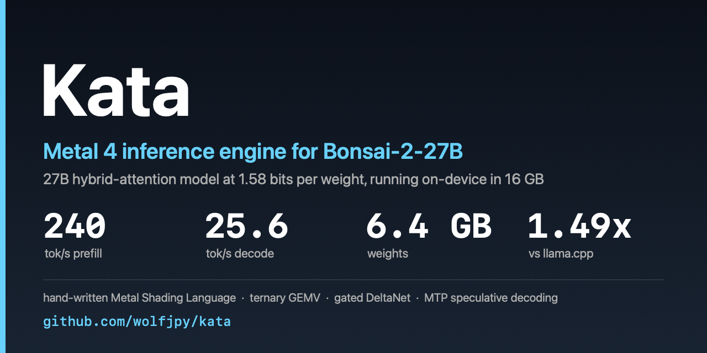

# Kata

**English** · [简体中文](README.zh-CN.md)



A from-scratch **Metal inference engine** for [Bonsai-2-27B](https://huggingface.co/prism-ml) — a 27B hybrid-attention
model whose weights are stored at **1.58 bits** (ternary ±1 with fp16 group scales) — running entirely on-device in a
16 GB Apple laptop.

No llama.cpp, no MLX, no MPS graph: every kernel is hand-written Metal Shading Language, including the on-the-fly 2-bit
weight decoder, the gated DeltaNet recurrence, the attention path, a tensor-core (`matmul2d`) prefill GEMM, and the MTP
speculative-decoding head.

**[Release v0.1.0](https://github.com/wolfjpy/kata/releases/tag/v0.1.0)** · **[Engineering log](docs/CHECKPOINT-001.md)** ([1](docs/CHECKPOINT-001.md) · [2](docs/CHECKPOINT-002.md) · [3](docs/CHECKPOINT-003.md) · [4](docs/CHECKPOINT-004.md), plus 29 milestone reports in [`docs/reports/`](docs/reports/)) — every optimisation decision with the measurement that justified it, including the ones that failed.

| | |
|---|---|
| **Weights on disk / in memory** | 6.4 GB single GGUF (27B parameters: ternary weights with fp16 group scales, plus a Q8_0 MTP head) |
| **Prefill** | 240 tok/s (`pp512`, exact) · 227 tok/s (7.3K prompt, `--fast-ffn`) |
| **Decode** | 18.9 tok/s plain autoregressive · 25.6 tok/s with MTP speculation · 31.6 tok/s on structured code |
| **Context** | 32K (fp16 KV ≈ 2.1 GB, int8 KV ≈ 1.1 GB, opt-in) |
| **Hardware** | Apple M6, 16 GB unified memory, Metal 4 |

---

## Highlights

- **Ternary weights, decoded in the kernel.** PTQ1_0 packs 5 weights into 2 bytes as base-3 digits. The GEMV kernel
  turns a 256-entry lookup table of 8-wide ternary patterns into one dispatch, so no dequantised copy of the model ever
  exists in memory.
- **Hybrid attention, both kinds.** 48 of the 64 layers are gated DeltaNet (conv state + delta-rule recurrence, one
  kernel per token, state kept in registers); the other 16 are GQA attention with per-head QK-norm, partial RoPE and a
  sigmoid output gate. The two paths are fused end to end in a single command buffer per layer.
- **Speculative decoding with the model's own MTP head** (blk.64, Q8_0): a one-token draft per step, verified in the
  same command buffer as the target forward, so a draft is never paid for twice.
- **Prefix cache.** A prompt whose token prefix was seen before restores its complete state (KV, conv state, recurrence
  state) from `~/.cache/kata` instead of prefilling it: a repeated 3.6K-token prompt goes from 18.6 s to 0.03 s, with
  byte-identical output.
- **A quality gate, not a vibe.** Every lossy switch is measured against the exact fp16 path with a KL / top-1 harness
  (`kata kl-eval`), and switches that fail it are documented as failed instead of shipped.

## Quick start

```bash
# 1. Build (Xcode command line tools; needs macOS 26+ and an SDK with Metal 4 / MPP)
make            # builds build/kata, build/kata.metallib and the dev tools

# 2. Get the model: a single GGUF (~6.4 GB), e.g.
#    hf download prism-ml/Bonsai-2-27B-gguf bonsai-2-27b-mtp-ptq1_0.gguf --local-dir models/

# 3. Run
build/kata run --model models/bonsai-2-27b-mtp-ptq1_0.gguf \
                 --prompt "Explain why a delta-rule recurrence is cheaper than attention at inference." \
                 --max-tokens 256

# 4. Interactive chat (streaming, thinking levels, prefix cache on by default)
build/kata chat --model models/bonsai-2-27b-mtp-ptq1_0.gguf
```

## Usage

```
kata run    --model M.gguf --prompt P [--system S] [--raw] [--no-think]
              [--effort xhigh|medium|low] [--temp T] [--top-k K] [--top-p P]
              [--max-tokens N] [--ctx N] [--no-spec] [--no-cache] [--exact]
kata chat   --model M.gguf [same options]
kata kl-eval --model M.gguf --file corpus.txt [--tokens N] [--save-ref R.bin | --ref R.bin]
kata verify-check --model M.gguf --ids "$(cat prompt.ids)"   # verifies the T=2 pass against exact single-token decode
```

Quality / performance switches:

| flag | effect | quality (top-1 / mean KL) |
|---|---|---|
| *(default)* | exact fp16 prefill, MTP speculative decoding on | reference |
| `--fast-ffn` | int8 FFN gate/up/down during prefill: **+10%** prefill | 99.87% / 7.5e-5 ✅ |
| `--fast` | int8 for every prefill matrix: +11% prefill | 98.48% / 0.0026 ❌ |
| `--kv int8` | int8 KV cache: half the KV memory, +14% decode at long context | 99.51% / coarse scales ⚠️ |
| `--exact` | force every lossy path off | reference |
| `--no-spec` | disable MTP speculative decoding | identical output |

## Performance

### Test machine

| | |
|---|---|
| Machine | Apple M6, 16 GB unified memory (fanless laptop) |
| OS / SDK | macOS 27.0.1, Xcode 27.1, SDK MacOSX27.0, Metal compiler 32023.921 (`metal4.1`) |
| Model | `Bonsai-2-27B` PTQ1_0 + MTP head, GGUF 6,397,969,920 bytes, sha256 `174c9c6584e118766d5511e00a84fd8a31d146248915a726cfac8e6d140c6204` |
| Kata build | this repository, `build/kata` + `build/kata.metallib` |
| Baseline build | llama.cpp, Prism fork, branch `prism`, commit `b3ebc47c286e58ead5fc6abb3655974d3bcc1355`, `llama-bench` from the same tree |

### Kata vs the llama.cpp reference (same machine, same GGUF)

| Measurement | llama.cpp `b3ebc47` | Kata | Ratio |
|---|---|---|---|
| Prompt processing, 512 tokens (`pp512`) | 211.4 ± 4.8 tok/s | 240.1 tok/s (exact) · 243.4 (`--i8 ffn`) | **1.14×** |
| Token generation, 128 tokens, plain autoregressive (`tg128`) | 17.2 ± 0.1 tok/s | 18.9 tok/s | **1.10×** |
| Token generation, 128 tokens, Kata default (MTP speculation on) | — (no MTP in `llama-bench`) | 25.6 tok/s | 1.49× |
| Prompt processing, 7.3K prompt | — (not run) | 227 tok/s (`--fast-ffn`) | — |

Baseline and Kata both run the *same* 6.4 GB GGUF on the same machine, back to back. The `tg128` row is the fair
like-for-like comparison (`llama-bench` is plain autoregressive; `build/kata --ids … --gen 128` is too). The third row
is Kata's shipped default, which adds MTP speculative decoding on top: **1.35× over its own plain path, 1.49× over the
baseline**. Numbers drift ±5% with thermal state on a fanless machine; run each three times and take the median.

### Kata detail (all with `--temp 0`)

| Workload | tok/s |
|---|---|
| Prefill, 1K tokens (exact / `--fast-ffn` / `--fast`) | 249 / 280 / 262 |
| Prefill, 7.3K prompt (`--fast-ffn`) | 227 |
| Decode, prose | 25.4 |
| Decode, reasoning text (MTP accepting 85–90% of drafts) | 28–29 |
| Decode, structured/greedy code | 31.6 |
| Decode, 29K context | 18.4 |

### How to repeat it

```bash
M=models/bonsai-2-27b-mtp-ptq1_0.gguf

# baseline: PP512 and TG128, 2 repetitions (mean ± sd is what llama-bench prints)
llama-bench -m $M -p 512 -n 128 -r 2
# -> pp512 211.42 ± 4.79 t/s | tg128 17.23 ± 0.11 t/s   (M6, build b3ebc47)

# Kata: prefill of the same 512-token prompt, and 128 tokens plain autoregressive
build/kata --model $M --ids "$(cat prompt512.ids)" --prefill --repeat 2
# -> prefill (fp16 exact path) of 512 tokens: 2.132 s = 240.1 tok/s
build/kata --model $M --ids "$(cat prompt512.ids)" --gen 128
# -> 18.94 tok/s (52.8 ms/token)

# Kata with speculation on (the default via the CLI)
build/kata run --model $M --raw --file prompt512.txt --temp 0 --max-tokens 128 --no-cache
# -> [prefill ... | decode 128 tokens in 5.00 s = 25.6 tok/s]
```

Decode is bound by streaming 6.4 GB of weights per token: at 25–31 tok/s the engine sustains roughly 160–200 GB/s of
effective weight traffic, which is where the roofline for this model sits on a laptop memory system. Prefill is bound by
the ALU cost of decoding 2-bit weights, not by bandwidth (`--fast-ffn` wins by shrinking the ALU work, not the bytes).

## Quality gates

Lossy switches are only accepted if they stay above **99.7% top-1** and below **KL 1e-3** against the exact fp16 path
over 3072 positions:

```bash
# exact vs int8 prefill (single process, both paths)
build/kata kl-eval --model $M --file corpus.txt --tokens 3072 --keep 256 --chunk 512

# a configuration that changes buffer layouts (e.g. int8 KV) needs two processes
KATA_KV=fp16 build/kata kl-eval --model $M --file corpus.txt --save-ref ref.bin
KATA_KV=int8 build/kata kl-eval --model $M --file corpus.txt --ref ref.bin
```

Current results: `--fast-ffn` 99.87% / 7.5e-5 ✅ · `--fast` 98.48% / 2.6e-3 ❌ · `--kv int8` **99.51% top-1** — one
scale per (position, KV head) covers 256 elements, so an outlier costs 1-2 effective bits. Asymmetric (mean + scale)
quantisation was implemented and measured *worse* (99.37%), because a head's values are already near-symmetric; opt-in,
not a default. (Its
mean-KL looks alarming only because a few positions have reference logits around 1e6, where a 0.5% relative error is a
5000-nat shift and the KL is meaningless; `KATA_KL_DBG=1` prints those positions.)
Speculative decoding and the prefix cache are exact by construction and verified byte-identical.

## How it works

```
x = embed(token)
for il in 0..63:
    h = rmsnorm(x, attn_norm[il])
    a = gated_delta_net(h)        if il % 4 != 3
      = gqa_attention(h)          if il % 4 == 3     # 16 layers, per-head QK-norm, partial RoPE, sigmoid gate
    x = x + a
    h = rmsnorm(x, post_attention_norm[il])
    x = x + ffn_down(silu(ffn_gate(h)) * ffn_up(h))
logits = lm_head(rmsnorm(x, output_norm))
```

Every ternary matmul rotates its input with a fast Walsh–Hadamard transform first (the quantisation basis), which is
fused into the RMSNorm kernel. One command buffer per layer keeps the ~50 dispatches of a decode token in flight without
a CPU round trip; the MTP draft, target forward and verification share that buffer.

Repository layout:

```
src/        engine (model, layers, kernels dispatch), session, sampler, tokenizer, chat template, CLI
shaders/    Metal kernels: ternary GEMV/GEMM, GDN, attention, norms, MPP matmul, quantisation
tools/      reference logit exporters, kernel microbenchmarks, quality harnesses
docs/       model spec, per-milestone reports, checkpoints
```

## What did not work (and why it is in the docs)

This engine has a paper trail of negative results, because they are the expensive part:

- **Turbo-fish 0.5-bit and 2:4 sparsity**: both need a different weight layout; measured slower than the 1.58-bit
  layout for this model.
- **Deeper MTP chains** (2–3 drafts): acceptance collapses in the chain path and, even at the reference acceptance
  rate, the wider verification costs 1.57× per round while producing 1.68× the tokens — a wash at best.
- **A DFlash2-style 7-token drafter**: the draft network's first-token agreement is only ~0.4 in this port, so the
  wide window does not pay off yet.
- **Wide verification on tensor cores**: the `matmul2d` path at M=16 runs at 9.4 TFLOPS (54% of peak on this chip),
  which puts the achievable speedup of an 8-row verification at 1.8×, not the 1.6× that would make deep speculation
  profitable. Two-row-group pipelining was implemented, measured 1.6× *slower*, and removed.

## Documentation

- **[`docs/README.md`](docs/README.md)** — bilingual documentation index: an English one-liner for every document, plus the Chinese original. Start here.
- **[`README.zh-CN.md`](README.zh-CN.md)** — this README in Chinese.

`docs/MODEL_SPEC.md` is the ground truth for the architecture (verified against the reference implementation and
per-layer logit dumps). `docs/CHECKPOINT-00{1..4}.md` are milestone summaries; `docs/reports/M*.md` are the individual
investigations, each with the measurement that justified the next step — including the ones that failed. The engineering
log is written in Chinese, in the order it happened; every document carries an English summary link at the top.

## Requirements

macOS on Apple Silicon with Metal 4 (MPP `matmul2d`), 16 GB of unified memory, Xcode command line tools. The engine
targets one model (Bonsai-2-27B, PTQ1_0 + MTP head) and one machine class; the kernels are specialised for the model's
shapes (hidden 5120, FFN 17408, 24 Q / 4 KV heads, vocab 248320) rather than general.

## References

This engine is a clean-room implementation, but it would not exist without these sources:

**The model and its quantisation format**
- Bonsai-2-27B (Prism) — model weights, config and the PTQ1_0 ternary quantisation format, plus the published
  whitepaper describing the architecture (`docs/reference/bonsai-2-27b-whitepaper.pdf`).
- `docs/MODEL_SPEC.md` — the architecture as verified against the reference implementation and per-layer logit dumps.

**Reference implementation**
- [llama.cpp](https://github.com/ggml-org/llama.cpp) (ggml) — the GGUF container format, the general graph structure,
  and the reference behaviour for sampling, chat templates and tokenizer handling.
- The Prism llama.cpp fork — `src/llama-graph.cpp` / `src/llama-model.cpp` for the Qwen3.5-style graph, the PTQ1_0
  dequantisation (`prism_ptq1_0_quant_dequant.c`), the Metal gated-DeltaNet kernel
  (`prism_metal_gated_delta_net.metal`) and the T=4 verification graph (`prism_qwen35_graph.cpp`). These were read as
  the specification for numerics; the kernels here are independently written.
- `third_party/metal-cpp` — Apple's metal-cpp headers, MIT, licence included in that directory.
- [baseRT](https://github.com/basecompute/baseRT) — reference reading for the Metal 4 / Metal Performance Primitives
  compute path (tensor ops, cooperative tensors, command-buffer structure).
- [ninfer](https://github.com/Neroued/ninfer) — a from-scratch Metal inference engine; useful as an independent
  comparison point for kernel structure and for what a hand-written Metal decoder costs in practice.
- [Strata](https://github.com/Niko1221/Strata) — reference for the layered Metal kernel organisation and dispatch
  patterns followed by `shaders/`.
- [Qwen3.8-27B-DFlash2-GGUF](https://huggingface.co/incoai/Qwen3.8-27B-DFlash2-GGUF) — the DFlash2 block-diffusion
  drafter weights used in the wide-window speculation experiments (`docs/reports/R2-dflash2-revisit.md`,
  `docs/reports/M28c-draft-forward.md`), and the reference for that drafter's GGUF layout.

**Apple / Metal**
- *Metal Shading Language Specification* (Metal 4) — the authoritative reference for the language, `simdgroup_matrix`,
  `threadgroup` memory and barrier semantics.
- *Metal Performance Primitives* (`MetalPerformancePrimitives/MetalPerformancePrimitives.h`) — `matmul2d_descriptor`,
  `matmul2d::run`, `cooperative_tensor`, `get_row_reduction_destination_cooperative_tensor`, which the prefill GEMM and
  the attention kernels are built on.
- *Metal Feature Set Tables* — for what is available at each `MTLGPUFamily` / Apple-GPU generation.

**Papers the algorithms come from**
- Yang, Kautz, Hatamizadeh, *Gated Delta Networks: Improving Mamba2 with Delta Rule* (2024) — the gated DeltaNet layer.
- Schlag, Irie, Schmidhuber, *Linear Transformers Are Secretly Fast Weight Programmers* (2021) — the delta rule.
- Ainslie et al., *GQA: Training Generalized Multi-Query Transformer Models* (2023) — the 24/4 grouped-query attention.
- Dao et al., *FlashAttention* (2022) — the tiled, online-softmax attention structure used in the prefill kernel.
- Leviathan, Kalman, Matias, *Fast Inference from Transformers via Speculative Decoding* (2023) — the draft/verify
  loop and its acceptance rule.
- Hu et al. / the MTP head design in DeepSeek-V3 (2024) — multi-token-prediction heads used as a self-draft.
- Ashkboos et al., *QuaRot* (2024) and Tseng et al., *QuIP#* (2024) — the randomised Hadamard transform used as the
  input basis for the ternary matmuls, and the incoherence argument behind it.

## License

MIT — see [LICENSE](LICENSE). Model weights are distributed by their authors under their own licence; nothing here
redistributes them.
